# Architecture Blueprint — ACR v1
**Status:** proposed · **Gate:** 4B

## Architectural style
A modular monolith, single TypeScript monorepo, deployed as three independent processes: `apps/web` (Next.js/React Flow), `apps/api` (Fastify/Zod), and `apps/worker` (durable processing). One PostgreSQL database is authoritative; pg-boss is the proposed queue. Runtime modules remain independently testable.

## Component diagram

```mermaid
flowchart TB
Browser --> Web[Next.js + React Flow]
Web --> API[Fastify Control API]
API --> PG[(PostgreSQL)]
API --> Planner[LLM Planner]
API --> Queue[pg-boss in PostgreSQL]
Queue --> Worker[Independent Worker]
Worker --> Runtime[Runtime Coordinator]
Runtime --> Engine[Pure Workflow Engine]
Runtime --> Policy[Policy Engine]
Runtime --> Registry[Connector Registry]
Registry --> External[Guarded HTTP / Demo CRM]
Worker --> PG
PG --> Events[Execution Events]
Events --> API
API --> Web
```

## Module boundaries
- `workflow-schema`: versioned discriminated node schemas and graph validation; no network or framework.
- `domain`: entities, invariants and state transitions; no ORM, Next.js or transport.
- `workflow-engine`: deterministic scheduling and transition planning; no LLM, HTTP, DB or UI.
- `workflow-runtime`: coordinates persistence, policy, queue and connector effects in worker.
- `policy-engine`: grants, effects, approval and destination rules; prompt text grants nothing.
- `connectors`: typed manifests, input/output schemas, idempotency and bounded execution.
- `ai-planner`: structured draft/classification proposals with provider adapter and schema validation.
- `database`: migrations, repositories and unit-of-work adapter.
- `apps/api`: auth, webhook intake, draft/publish/approve endpoints, event replay/SSE; **never** performs long-running workflows.
- `apps/web`: authoring, inspector and approvals; never owns secrets or direct database access.

## Invariants
1. Workers alone perform side effects.
2. An execution pins a published immutable workflow version.
3. PostgreSQL records are the authoritative record; queue messages and SSE are delivery mechanisms.
4. LLM output is untrusted data, not executable instructions.
5. External write uncertainty is explicit and never retried blindly.
6. Public demo cannot execute arbitrary outbound requests or touch ClickDialog infrastructure.

## Hosting
Local: Docker Compose (web, API, worker, Postgres). Public portfolio deployment: isolate web from worker and store; Vercel Hobby is only a candidate for a **noncommercial frontend**, never the persistent worker. A separate managed-service business remains optional.

## Decision gates
Verify Prisma/pg-boss transaction compatibility on pinned versions, define guest isolation and budgets, finalise SSRF egress policy and credential lifecycle, approve contract schemas and database indexes.
