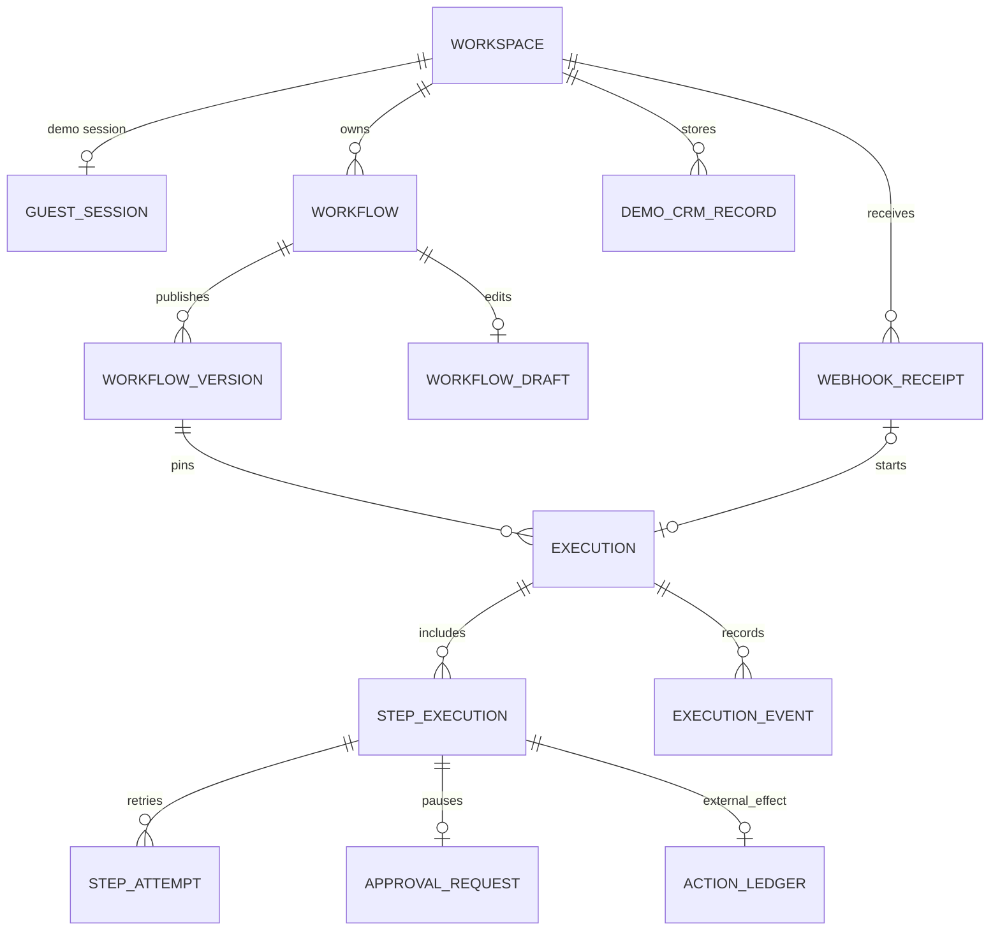

# ACR v1 — Domain Model & Invariants

> **Versión:** 0.2 · **Gate:** 4B · **Estado:** propuesta técnica detallada, **no aprobada** · **Fecha:** 2026-11-04
>
> El PRD de Gate 4A define el producto. Este documento define la propiedad de los datos y las invariantes; el SQL definitivo y las migraciones se implementan en Gate 4C/5, luego de validar el modelo con PostgreSQL real.

## 1. Agregados principales y límites

- **Workspace** es el límite de autorización. En demo, un workspace es efímero y pertenece a una sesión; en modo operador es persistente.
- **Workflow** contiene identidad y puntero a versión publicada. Su borrador se modifica independientemente del historial.
- **WorkflowVersion** es un snapshot inmutable de grafo y política de publicación.
- **Execution** representa una corrida de una versión exacta y es el agregado de estado: steps, aprobaciones y eventos.
- **ActionLedger** registra cada intención de producir efectos externos y su resultado, incluso si queda incierto.
- **WebhookReceipt** deduplica la entrada antes de crear una Execution.
- **DemoCRMRecord** se guarda dentro de un Workspace y no constituye una integración con proveedores reales.

No existe agregado de billing, suscripciones, planes de pago, clientes reales ni jerarquía empresarial multiusuario en v1.

## 2. Diagrama lógico de relaciones

Todas las tablas transaccionales de un Workspace deben contar con `workspaceId` o una FK autorizada e inequívoca a ese Workspace. El `workspaceId` redundante en tablas críticas permite filtrar consistentemente y verificar FKs compuestas cuando corresponda.

## 3. Especificación de entidades y claves

| Entidad | Campos clave propuestos | Unicidad / índice principal |
|---|---|---|
| `Workspace` | `id`, `mode: demo/operator`, `status`, `createdAt`, `expiresAt?` | PK `id`; índice expiración demo |
| `GuestSession` | `id`, `workspaceId`, `tokenHash`, `lastSeenAt`, `expiresAt`, `absoluteExpiresAt` | UNIQUE `tokenHash`; UNIQUE `workspaceId` |
| `Workflow` | `id`, `workspaceId`, `name`, `activeVersionId?`, `revision` | PK `id`; índice `workspaceId` |
| `WorkflowDraft` | `id`, `workflowId`, `schemaVersion`, `graph:jsonb`, `revision`, `updatedAt` | UNIQUE `workflowId`; CAS al actualizar |
| `WorkflowVersion` | `id`, `workflowId`, `versionNo`, `schemaVersion`, `graph:jsonb`, `graphDigest`, `policySnapshot:jsonb`, `publishedAt` | UNIQUE (`workflowId`,`versionNo`) |
| `WebhookReceipt` | `id`, `workspaceId`, `sourceId`, `sourceEventId`, `receivedAt`, `requestDigest` | UNIQUE (`workspaceId`,`sourceId`,`sourceEventId`) |
| `Execution` | `id`, `workspaceId`, `workflowVersionId`, `receiptId?`, `status`, `revision`, `lastEventSeq`, `startedAt?`, `finishedAt?` | índice (`workspaceId`,`createdAt`); UNIQUE `receiptId` cuando existe |
| `StepExecution` | `id`, `executionId`, `nodeId`, `status`, `revision`, `attemptCount`, `nextRetryAt?` | UNIQUE (`executionId`,`nodeId`) |
| `StepAttempt` | `id`, `stepExecutionId`, `attemptNo`, `startedAt`, `finishedAt?`, `errorCode?`, `outputDigest?` | UNIQUE (`stepExecutionId`,`attemptNo`) |
| `ExecutionEvent` | `id`, `executionId`, `sequence`, `eventType`, `sanitizedPayload:jsonb`, `createdAt` | UNIQUE (`executionId`,`sequence`) |
| `ApprovalRequest` | `id`, `executionId`, `stepExecutionId`, `status`, `payloadDigest`, `expiresAt`, `decidedAt?`, `actorRef?` | UNIQUE `stepExecutionId`; índice `status,expiresAt` |
| `ActionLedger` | `id`, `executionId`, `stepExecutionId`, `operationKey`, `status`, `providerRef?`, `resultDigest?`, `updatedAt` | UNIQUE `operationKey`; UNIQUE `stepExecutionId` para v1 |
| `DemoCRMRecord` | `id`, `workspaceId`, `externalKey`, `syntheticLead:jsonb`, `updatedAt` | UNIQUE (`workspaceId`,`externalKey`) |
| `ConnectorCredential` | `id`, `workspaceId`, `connectorKey`, `encryptedSecret`, `keyVersion`, `createdAt` | índice por `workspaceId,connectorKey`; **no** exponer en eventos |

La metadata de autenticación de operador se aloja separada del dominio; la cookie anónima contiene un token opaco que se compara contra `tokenHash`, nunca el secreto plano guardado en DB.

## 4. Estados: taxonomía v1

| Agregado | Estados | Terminales |
|---|---|---|
| `Execution` | `queued`, `running`, `waiting_approval`, `retrying`, `needs_review`, `completed`, `failed`, `cancelled` | `completed`, `failed`, `cancelled`, `needs_review` (hasta resolución operatoria explícita) |
| `StepExecution` | `pending`, `ready`, `running`, `waiting_approval`, `retrying`, `succeeded`, `failed`, `skipped`, `cancelled`, `needs_review` | `succeeded`, `failed`, `skipped`, `cancelled`, `needs_review` |
| `ApprovalRequest` | `pending`, `approved`, `rejected`, `expired`, `cancelled` | todos excepto `pending` |
| `ActionLedger` | `prepared`, `dispatching`, `confirmed`, `failed`, `uncertain` | `confirmed`, `failed`, `uncertain` (requiere revisión) |

`needs_review` no se reintenta automáticamente. Si en una versión posterior se permite resolverlo manualmente, deberá quedar una operación explícita auditada que cree una transición válida o una nueva ejecución. No existe «reset a running» silencioso.

## 5. Reglas de consistencia

1. **Scope:** cada lectura/escritura/efecto verifica `workspaceId` validado desde sesión o identidad de operador, nunca desde el body.
2. **Inmutabilidad:** una vez publicado, `WorkflowVersion.graph`, `graphDigest` y `policySnapshot` no se actualizan. Publicar otra versión genera otra fila, y un run existente mantiene la FK original.
3. **Hash estable:** `graphDigest` utiliza JSON canonicalizado con algoritmo identificado (propuesta SHA-256); los secretos jamás se incluyen.
4. **CAS:** toda transición de Execution, StepExecution y edición de Draft comprueba `revision` esperada; un competidor que pierde el CAS debe recargar y no realizar side effects.
5. **Secuencia única de eventos:** asignar `sequence` incrementando `Execution.lastEventSeq` en **la misma transacción** que persiste estado + evento; no usar `MAX(sequence)+1` en procesos concurrentes.
6. **Idempotencia de entrada:** receipt UNIQUE por fuente/evento; replays devuelven la misma ejecución vinculada o estado explícito, no crean otra.
7. **Approval única:** una aprobación pertenece al step, incorpora digest de efecto propuesto, actor y plazo. La decisión final ocurre una sola vez con bloqueo transaccional/CAS.
8. **Effect ledger:** `operationKey = hash(executionId,nodeId,ordinal)` estable para todos los reintentos; para MVP una sola acción externa por nodo. El provider puede requerir clave adicional dentro de sus límites.
9. **Exactly once:** la DB local puede imponer unicidad, pero un HTTP externo genérico no garantiza exactamente un efecto.
10. **No exposición accidental:** payloads de eventos, logs y datos enviados a LLM deben ser sanitizados/redactados según la política de datos.

## 6. Grafo de v1: ejecución **secuencial** con rama exclusiva

Para mantener el motor implementable y verificar sus invariantes:

- Workflow publicado es DAG; exactamente un `webhook.trigger`; cada nodo ejecutable se alcanza desde el trigger.
- **Máximo un paso ejecutable activo por run** en MVP. No hay fanout paralelo ni joins.
- `condition` puede tener dos salidas mutuamente excluyentes (`true`/`false`); la rama no elegida se marca `skipped` de forma determinista.
- Otros nodos ejecutables tienen una sola arista de salida o terminan en `finish`. El contrato preciso de condiciones y skips se termina en Gate 4C.
- No hay loops, reentrancia, subworkflows ni eventos que disparen otra versión de la misma ejecución.
- Límite de 12 nodos / 20 aristas / profundidad 10 por workflow de demo; valores para operador podrán revisarse explícitamente más adelante.

Esto no compromete un motor paralelo completo en v1; demuestra semántica de DAG, condiciones y recuperabilidad sin inflar la complejidad.

## 7. Datos efímeros y retención

- `Workspace.mode=demo` expira a más tardar 24 h desde creación; `GuestSession` expira por inactividad 30 min o por plazo absoluto 24 h.
- Un worker de cleanup elimina en lotes sesión, workflow, versions, receipt, executions, steps, approvals, events, ledger y CRM del workspace expirado. Las consultas a workspace expirado se rechazan aunque el cleanup esté retrasado.
- Workspaces `operator` no siguen esa política; retención y borrado deliberado se define en Gate 4E/4F.
- Definir relaciones `ON DELETE CASCADE` controladas **solo** para cascadas de demo tras expiración autorizada; no exponer una ruta anónima para borrar registros de otro workspace.

## 8. Migraciones, índices y pruebas por completar

**Gate 4C/5:** generar esquema Prisma y migraciones SQL reales; probar constraints UNIQUE/FK/CHECK, CAS bajo carrera, ordering de eventos, publicación simultánea, limpieza concurrente y aislamiento de sesiones. Estas invariantes son objetivo de diseño, no evidencia de pruebas ya ejecutadas.

**Aceptación de Gate 4B:** cada entidad tiene dueño, FK/unicidad, máquina de estados y regla de concurrencia; un implementador puede traducirlo en migraciones y tests sin suponer cómo resolver fallos.

Referencias: [PRD](../product/PRD.md) · [Execution Semantics](EXECUTION_SEMANTICS.md) · [ADR 0004](../adr/0004-immutable-versioned-dag.md) · [ADR 0009](../adr/0009-action-ledger-idempotency.md).
