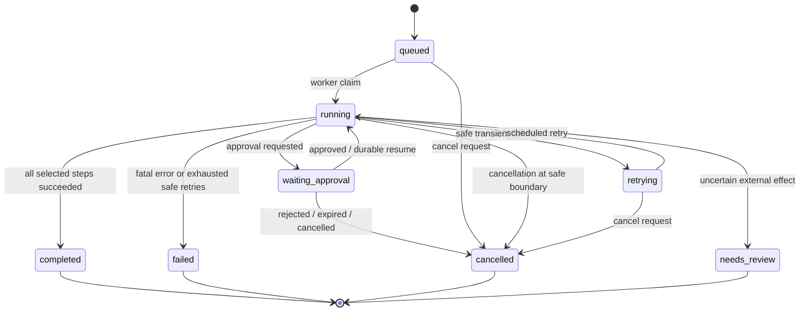
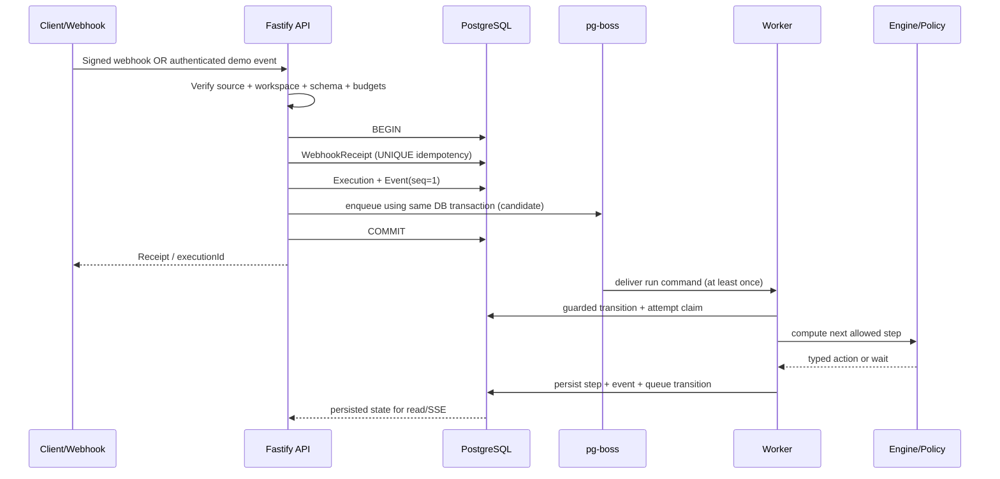
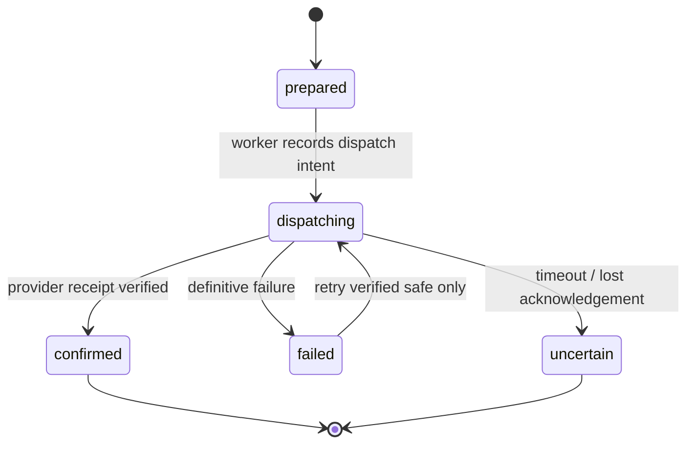

# ACR v1 — Execution Semantics & Reliability

> **Versión:** 0.2 · **Gate:** 4B (modelo) + 4D (evidencia real) · **Estado:** propuesta, **no probada**.
>
> Este documento describe semánticas y garantías deseadas. La elección exacta de pg-boss, la transacción compartida con Prisma y la recuperación tras fallos requieren un spike contra PostgreSQL real antes de declararse verificadas.

## 1. Principios

1. Una Execution usa una única versión publicada e inmutable del workflow.
2. Solo el worker coordina cambios de estado del workflow y side effects. El API recibe comandos y persiste solicitudes.
3. El motor de decisión puro solo calcula transiciones `(state,event) -> command[] + state'`; no conecta a DB, LLM ni HTTP.
4. PostgreSQL es la fuente de verdad; la cola realiza delivery **at-least-once**; SSE refleja eventos persistidos.
5. En MVP el DAG es **secuencial**: a lo sumo un nodo ejecutable a la vez por Execution. La condición elige una sola rama.
6. Una acción externa nunca se reintenta de forma automática si su estado final es incierto y el proveedor no permite reconciliar/idempotencia.

## 2. Máquina de estados de Execution

### Tabla normativa de transiciones

| From | Event/condition | To | Acción durable |
|---|---|---|---|
| `queued` | worker acquires next command | `running` | CAS + start event |
| `running` | step succeeds, next step ready | `running` | Persist step and schedule next |
| `running` | approval node reached | `waiting_approval` | Persist request + event; no side effect |
| `waiting_approval` | approved by authorized actor before expiry | `running` | Atomic CAS approval + resume job |
| `waiting_approval` | rejected/expired | `cancelled` | Persist terminal decision + event |
| `running` | retry-safe transient failure | `retrying` | Persist `nextRetryAt`, attempt, enqueue |
| `retrying` | retry command due | `running` | CAS + attempt event |
| `running` | non-retryable error or safe retry budget exhausted | `failed` | Failure event and sanitized code |
| `running` | external outcome ambiguous | `needs_review` | Ledger `uncertain`; prohibit blind retry |
| `running` | selected path complete | `completed` | Terminal event and result digest |
| `queued/running/retrying` | cancellation at safe boundary | `cancelled` | Persist cancellation + event |

Unknown event, stale revision, terminal mutation and unauthorized transition return a **typed error** without modifying state. Cancel is best effort relative to a connector in flight; a write already completed is not rolled back by cancelling the Execution.

## 3. StepExecution semantics

- `pending` until dependencies are resolved; `ready` means eligible for execution; `running` tracks current attempt.
- `succeeded` persists typed output/digest and unlocks next step.
- `skipped` explicitly records a branch not selected by `condition`.
- `waiting_approval` persists a request that can outlive the worker process.
- `retrying` records a deadline and reason; a job may be delivered repeatedly but must not generate two concurrent effects.
- `failed`, `cancelled`, `needs_review` are terminal for that step in v1.
- Each retry is represented by a distinct `StepAttempt` unique on `(stepExecutionId,attemptNo)`; state progress and attempt events are persisted in one DB transaction.

### Limited branching v1

Only `condition` may have two outgoing edges, `true` and `false`. Evaluator selects exactly one edge; unselected branch is marked skipped until the next terminal boundary. **Parallel fanout, join, loop and recursive steps are prohibited** in publish-time graph validation. Exact branch grammar is contract Gate 4C.

## 4. HTTP intake → execution → worker

**Transactional queue caveat:** the `BEGIN/COMMIT` section assumes an **adapter sharing the exact physical PostgreSQL transaction connection** with pg-boss. The ability to enqueue with Prisma transaction must be demonstrated with pinned compatible versions; merely using the same database is not atomic. If the spike fails, choose a **transactional outbox table** in the same commit and a separate dispatcher that publishes at least once.

### Duplicate intake

`WebhookReceipt` has UNIQUE `(workspaceId,sourceId,sourceEventId)`. A repeated webhook gets the existing execution ID (or a stable duplicate acknowledgement) after verifying scope, signature and replay window; a concurrent insert must be handled by unique violation/UPSERT, not optimistic "read then create" without constraint.

Demo event has its own source namespace and is authorized by anonymous session; signed HTTP webhook has different authentication and source semantics. Both call the same internal `startExecution` service.

## 5. Human approval: pause and resume safely

1. Worker reaches approval node and persists `ApprovalRequest(status=pending, payloadDigest, expiresAt)`, `StepExecution(waiting_approval)`, `Execution(waiting_approval)` and event atomically.
2. Worker finishes its job; **no waiting worker process** or open HTTP request is retained.
3. API receives approve/reject request with operator/workspace scope or owner demo-session scope, validates expiry and digest, then obtains DB lock/CAS.
4. Decision is stored **once**. Approve atomically persists an event and a resume command (transactional queue/outbox); reject/expire persists `cancelled` without calling connector.
5. Duplicate clicks or competing expiry job result in one winner; loser reads final state and receives stable response.
6. Approved payload cannot be changed between approval and side effect: `payloadDigest` and relevant policy snapshot are verified at resume.

Guest approval expiry target: 10 minutes. No automatic approval on timeout.

## 6. External effects and ActionLedger

**Operation key** for one effect per node: SHA-256 of canonical `(executionId,nodeId,ordinal=0)`, stable across retries.

- Before dispatch: authorize effect, restrict destination, resolve secret, validate payload, and persist `prepared` with operation key and input digest.
- Immediately before network call: persist `dispatching`; crash after this point may mean an unknown external outcome.
- Use provider idempotency key and reconciliation/read-after-write if supported and trustworthy. Do not claim generic exactly-once guarantees.
- Demo CRM is local PostgreSQL; upsert keyed by `(workspaceId,externalKey)` is idempotent. It can be applied in a transaction that includes ActionLedger confirmation and event.
- For a non-idempotent API with ambiguous outcome, persist `uncertain`, transition Execution to `needs_review`, and stop. No automatic replay.
- A timed-out or disconnected call may **still have succeeded remotely**; error codes must distinguish definitive rejection from uncertainty.
- `confirmed` result is immutable and re-delivery returns the persisted outcome rather than re-sending a write.

## 7. Lease, retry and crash behavior

- Queue delivery is at least once. A worker must acquire step/attempt under CAS and prevent concurrent dispatch of the same action.
- Lease expiry does **not** prove the old worker stopped making network calls. Provider idempotency/reconciliation plus ActionLedger decide whether redispatch is safe.
- Retries: at most **two additional** automatic attempts in guest demo for errors explicitly classified safe; bounded exponential backoff with jitter. Quota/time budget applies across retries.
- Crash **before** durable dispatch intent can be retried safely if no effect occurred; crash **after** `dispatching` requires reconciliation, idempotency semantics or review.
- Restart must recover queued jobs and pending approvals. SSE disconnect never changes run status.
- Tests must interrupt worker at: before enqueue commit; after enqueue; before/after dispatch flag; after external success before ledger confirmation; pending approval; after approval decision before resume delivery.

## 8. Cancellation, timeouts and budgets

- Demo session: 1 active run, 5 starts/day, max 90 s **active processing time** excluding max 10 min approval wait; per-step max 10 s. The enforcement method is a Gate 4C/4D contract, not a process-local timer alone.
- `cancel` is a request accepted at safe execution boundaries, not a promise to undo writes. If a connector was dispatched, cancellation waits for confirmed/failed/uncertain classification and records resulting final state.
- Approval expiry can cancel execution, but must compete safely with approval through atomic DB state transition.
- Workflow publish validates 12 nodes / 20 connections / depth 10 in demo.
- Worker-level global guest concurrency cap is 4, enforced in durable shared infrastructure rather than frontend state.

## 9. Event ledger and SSE

`Execution.lastEventSeq` increments under the same transaction as an execution/step transition; inserted `ExecutionEvent.sequence` is UNIQUE `(executionId,sequence)`. API queries events ordered by this cursor and serves SSE events with `id=sequence`; client resumes using `Last-Event-ID`.

SSE carries already-persisted redacted data, is authorization-scoped and is **not** a secondary source of truth. Heartbeats have no domain sequence and must not affect replay.

## 10. Verification matrix and open decisions

| Failure case | Expected invariant | Evidence required |
|---|---|---|
| Commit+enqueue | Both execution and job visible | PostgreSQL integration test |
| DB rollback | Neither visible | PostgreSQL integration test |
| Duplicate webhook | Same execution, no duplicate | Unique constraint race test |
| Concurrent approval/expiry | Single terminal winner | Parallel transaction test |
| Worker crash before dispatch | Recover without external duplicate | Fault injection |
| Crash after provider effect before receipt | Reconcile/idempotent or needs_review | Fake provider with uncertain ack |
| Retry safe demo CRM upsert | One CRM record, multiple logged attempts | DB and event comparison |
| SSE disconnect / cursor | No missing or duplicate rendered events | Browser/API test |
| Cross-workspace execution | No read/write/approve leakage | Negative authorization test |

**Gate 4B** accepts the state machine and invariants as a contract only after review. **Gate 4D** requires working tests with pinned PostgreSQL/Prisma/pg-boss versions or an approved transactional outbox fallback.

Referencias: [Domain Model](DOMAIN_MODEL.md), [PRD](../product/PRD.md), [Quality](../quality/ACCEPTANCE_TESTS.md), [ADR 0003](../adr/0003-postgres-queue-pg-boss.md), [ADR 0009](../adr/0009-action-ledger-idempotency.md).

## Gate 4D isolated verification spike

An isolated experiment lives in [`spikes/gate4d/`](../../spikes/gate4d/README.md). It pins Prisma 7.10.1, pg-boss 12.38.0 and PostgreSQL 17 and exercises the `fromPrisma(tx)` adapter against real PostgreSQL. **CI PASS (2026-11-04):** [run 41836485254](https://github.com/AlexiVion/automation-control-room/actions/runs/41836485254) verifies 9 PostgreSQL test cases with pinned dependencies, including atomic approval-resume enqueue and real OS-level SIGKILL of a worker after it claims a job. The recovered worker writes one local CRM record. The SIGKILL occurs **before any external provider call**. Remote HTTP uncertainty and atomic worker acknowledgement with Prisma business writes remain separate implementation concerns; a full workflow/API has not been built.
