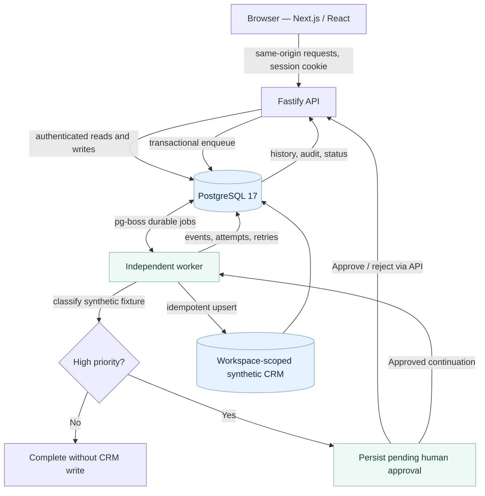

# Architecture at a glance

A technical explainer for engineers reading ACR from GitHub or LinkedIn. **This diagram depicts only the current synthetic local demonstration.**

## What is demonstrably implemented

**Presentation:** Next.js / React browser UI, published workflow canvas, node inspector, history list, synthetic CRM table, focus mode and mobile workflow list.

**API:** Fastify endpoint handlers for local guest sessions, scoped run lookup and keyset history, deterministic demo event intake, approvals, CRM and published graph retrieval. Session cookies, Origin + CSRF, workspace scoping, TTL and quotas are tested.

**Persistence and execution:** Prisma 7 and PostgreSQL 17; pg-boss worker for background jobs. The worker's result, approvals and event timeline are stored in the database. Controlled retry and a workspace-scoped idempotent CRM write are covered by HTTP E2E tests.

**Verification:** TypeScript, Vitest, real Postgres tests, Docker Compose, a browser-driven Chromium journey and an owner-run Windows proof of `SLICE2_FINAL_WINDOWS_PASS`.

## What is deliberately absent

No visual graph editor/publisher, general DAG interpreter, live LLM calls, third-party credentials, remote HTTP effects, operator identities, billing or public hosting. There are typed interfaces and architectural proposals for future work, **not a claim that those capabilities are running**.

## Architecture decisions worth discussing

- Durable state is in PostgreSQL, **not** in the React component or a fragile in-memory queue.
- Human approval gates the synthetic CRM effect; fixture classification cannot authorize publishing or external actions.
- Idempotency and retries prevent duplicate local CRM writes in the controlled failure scenario.
- A canonical published graph provides visual explanation without pretending the current demo is an editable workflow platform.
- Guest workspaces are isolated and expiring; data in another session is intentionally invisible.
- The demonstration works without paid inference APIs or third-party credentials.

See the [source architecture docs](../architecture/ARCHITECTURE.md), [execution semantics](../architecture/EXECUTION_SEMANTICS.md), [security model](../security/SECURITY_CONTROLS.md) and [Slice 2 implementation](../phase5/SLICE2.md).
