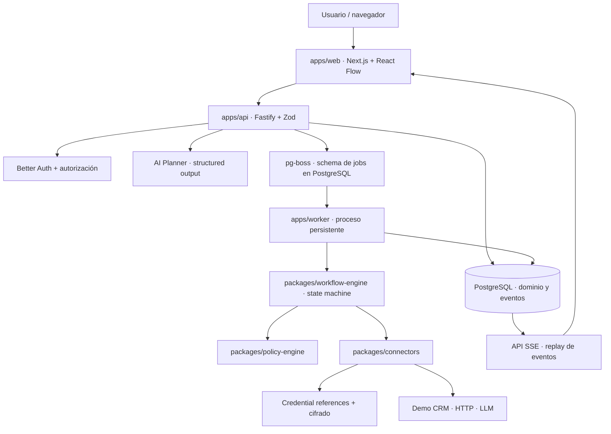
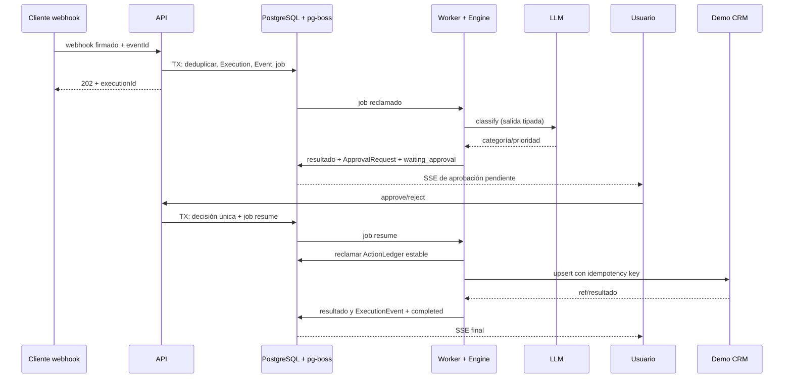

# Automation Control Room — Informe de arquitectura recomendada

**Versión:** 1.0 — propuesta para revisión (Fase 4)  
**Fecha:** 3 de noviembre de 2026  
**Estado:** Arquitectura recomendada; contratos y ADR todavía pendientes de aprobación e implementación.  
**Propósito:** sustentar decisiones, delimitar el MVP y establecer la documentación necesaria para desarrollar un producto open source propio.

> **Alcance de evidencia.** Este informe utiliza la investigación comparativa previa de Sim, Activepieces, Windmill y Trigger.dev, así como otras cinco referencias. La investigación examinó código accesible, estructuras y documentación pública, **no ejecutó ni clonó** los repositorios. Por tanto, los patrones observados no deben confundirse con pruebas de rendimiento ni certificaciones. Se distinguen hallazgos documentados de elecciones recomendadas para Automation Control Room (ACR).

## 1. Recomendación ejecutiva

Recomiendo construir **un monolito modular en un monorepositorio TypeScript, desplegado como tres procesos independientes (web, API y worker)**. PostgreSQL será la fuente única de verdad del estado empresarial y también alojará una cola pg-boss. El motor de workflows será **propio, tipado, determinista y sin ejecución de código arbitrario de usuarios en el MVP**. La IA propondrá definiciones de procesos y clasificará datos, pero no tendrá autoridad para invocar herramientas externas sin atravesar el motor de políticas y las aprobaciones humanas.

El proyecto debe tener **identidad, repositorio, infraestructura, secretos y despliegues independientes de ClickDialog**. Debe ser ejecutable mediante Docker Compose, con licencia Apache-2.0 y una demo pública de procesamiento de leads. La posibilidad de un servicio administrado por ClickDialog se preserva mediante interfaces y límites arquitectónicos, **no incorporando Mercado Pago o facturación ahora**.

Esta arquitectura minimiza los servicios operativos, permite demostrar frontend, backend, bases de datos, integraciones, IA, seguridad, asincronía y pruebas E2E; y evita reproducir la complejidad de plataformas maduras.

### Principios no negociables

1. **Una definición, dos modos de autoría:** manual y lenguaje natural producen el mismo `WorkflowDraft` validable.
2. **Separación entre planificación y ejecución:** el LLM no ejecuta herramientas; el backend valida permisos y acciones.
3. **Durabilidad:** la ejecución y sus transiciones se persisten; no dependen de una pestaña abierta ni de la memoria de un proceso.
4. **Repetición segura:** los workers pueden ejecutar jobs más de una vez; las acciones externas requieren tratamiento explícito de idempotencia e incertidumbre.
5. **Inspeccionabilidad:** cada run contiene pasos, eventos, motivos de decisiones y resultados sanitizados.
6. **Código primero:** se usan bibliotecas estándar, pero el dominio, el workflow engine y los contratos de conectores son propios.
7. **Open source auténtico:** instalación self-hosted funcional sin suscripción, claves de facturación ni servicios de ClickDialog.
8. **Evolución controlada:** una versión publicada es inmutable; la arquitectura puede crecer sin anticipar una plataforma empresarial completa.

## 2. Qué aprendimos de los repositorios de referencia

| Proyecto | Revisión fijada en la investigación | Enseñanza útil | Qué NO copiar |
|---|---|---|---|
| [Sim](https://github.com/simstudioai/sim/tree/093ea9ddb2f3e47facbc2dc42d4e523ba050dedb) | `093ea9ddb2f3e47facbc2dc42d4e523ba050dedb` | Editor, contratos de grafos, aprobaciones durables, herramientas de IA | Executor entero, partes `ee/`, infraestructura de agentes sobredimensionada |
| [Activepieces](https://github.com/activepieces/activepieces/tree/e4a6bb4f41daee9bbfaa20a71f4510fb980680d5) | `e4a6bb4f41daee9bbfaa20a71f4510fb980680d5` | Separación App/Worker/Engine/Sandbox, catálogo de conectores tipados | Sandbox completo, cientos de piezas, `ee/` |
| [Windmill](https://github.com/windmill-labs/windmill/tree/fe8504583cb7049612ccc872afc511547a98c71f) | `fe8504583cb7049612ccc872afc511547a98c71f` | Trabajos durables en PostgreSQL y workers independientes | Código AGPL o ejecutores multi-lenguaje |
| [Trigger.dev](https://github.com/triggerdotdev/trigger.dev/tree/645cc47dd2eeb99387f604cad2c90ba2ef568680) | `645cc47dd2eeb99387f604cad2c90ba2ef568680` | Lifecycle, supervisor, recuperación, eventos y autorización por entorno | Orquestación a escala con contenedores y ClickHouse |

**Referencias complementarias:** [Kestra](https://github.com/kestra-io/kestra) (control/ejecución); [Langflow](https://github.com/langflow-ai/langflow) (capas de agentes); [Flowise](https://github.com/FlowiseAI/Flowise) (editor de agentes, repositorio archivado al momento de la consulta); [Automatisch](https://github.com/automatisch/automatisch) (integraciones); [n8n](https://github.com/n8n-io/n8n) (nodos y UX, licencia no OSI). Ningún repositorio justifica hacer un fork.

Rutas especialmente útiles para posteriores verificaciones puntuales:

- [Sim: human-in-the-loop manager](https://github.com/simstudioai/sim/blob/main/apps/sim/lib/workflows/executor/human-in-the-loop-manager.ts).
- [Activepieces: visión general de arquitectura](https://github.com/activepieces/activepieces/blob/main/docs/install/architecture/overview.mdx).
- [Windmill: backend, API, queue y workers](https://github.com/windmill-labs/windmill/tree/main/backend).
- [Trigger.dev: guías internas y arquitectura](https://github.com/triggerdotdev/trigger.dev/blob/main/AGENTS.md).

**Interpretación:** estos proyectos muestran **patrones de ingeniería**, no componentes intercambiables. La decisión de ACR debe apoyarse en nuestras necesidades y en pruebas propias.

## 3. Producto objetivo y límites

### Usuarios y propuesta de valor

- **Usuario principal inicial:** desarrolladores, perfiles técnicos y evaluadores del portfolio que necesitan comprobar un proceso automatizado de principio a fin.
- **Usuario secundario futuro:** pequeñas empresas que quieran automatizar operaciones sin escribir código para cada caso.
- **Valor principal:** crear workflows a mano o mediante lenguaje natural, **aprobar** lo que harán, **ejecutarlos** de manera durable y **entender** todo lo que pasó.

### Demostración principal

Escenario: una nueva consulta comercial llega por webhook; la IA la clasifica según un esquema definido; el motor consulta y prepara la actualización del CRM; el usuario revisa una aprobación humana; el worker realiza un `upsert` idempotente en un CRM ficticio y el inspector muestra las transiciones, tiempos, reintentos y resultado.

La demo debe permitir también una ejecución con **fallo controlado** del CRM y una prueba de envío duplicado. No basta con reproducir una animación; todas las visualizaciones deben corresponder a datos persistidos.

### MVP incluido

- Autenticación para el espacio de trabajo y **modo de demostración acotado**.
- Editor de workflow visual limitado a los tipos admitidos; generación asistida por IA del mismo formato.
- Publicación/versionado, validación de grafo y ejecución asincrónica.
- Webhooks, acciones HTTP con destinos aprobados, condición, clasificación IA, aprobación y CRM ficticio.
- Historial de runs, steps, eventos, reintentos, errores, cancelación y reanudación.
- Docker Compose, CI, documentación, pruebas unitarias/integración/E2E.

### Fuera del MVP

- Mercado Pago, checkout, planes, límites de facturación y servicio cloud multiempresa completo.
- Marketplace de conectores, plugin installations dinámicas y OAuth genérico para cientos de apps.
- Ejecutar JavaScript/Python aportado por usuarios, `eval()`, shell o navegador autónomo.
- Workflows cíclicos, bucles ilimitados, subworkflows recursivos y coordinación multiagente libre.
- Alta disponibilidad distribuida, Kubernetes, ClickHouse, Redis y escalado a gran volumen.
- Integraciones reales con CRM de terceros que exijan cuentas empresariales para probar la demo.

## 4. Arquitectura recomendada



**Tipo de arquitectura:** monolito modular, no microservicios. El código reside en un solo monorepo y comparte contratos, pero la web, API y worker se ejecutan en procesos separados. El backend sigue siendo un producto cohesivo; no necesita redes de servicios, service mesh ni comunicación asíncrona para todo.

### 4.1 Capa de presentación — `apps/web`

**Stack:** Next.js, React, TypeScript, Tailwind CSS, componentes accesibles y `@xyflow/react` (React Flow).

**Responsabilidades:** editor visual, formularios, páginas de workflow, panel de aprobación, inspector de ejecuciones, estado en vivo y modo demo. Mantiene estado temporal de edición, pero **no** decide cuándo una acción externa está autorizada. No es fuente de verdad de un run.

**Por qué:** Next.js es fácil de desplegar y demostrar; React Flow ofrece zoom, drag-and-drop y conexiones de nodos como biblioteca MIT, dejando nuestro esfuerzo en lógica de producto, no en dibujar el canvas.

**Alternativa descartada inicialmente:** frontend Svelte independiente o construir el editor desde cero. Aumentan coste y no mejoran la señal de ingeniería del portfolio.

### 4.2 API de control — `apps/api`

**Stack:** Fastify + TypeScript + Zod; documentación OpenAPI; autenticación con Better Auth, con autorización por recurso propia.

**Responsabilidades:** autenticación, workspace, CRUD de borradores, validación y publicación, webhooks, approvals, cancelación, consulta de runs y SSE.

**Por qué:** separa el protocolo y el control plane del frontend. No obliga a ejecutar jobs durante un request serverless. Mejor Auth documenta integración directa con Fastify, pero se debe verificar cookies, CORS, CSRF y sesiones en el despliegue elegido.

**Invariante:** todas las operaciones sobre `Workflow`, `Execution`, `Credential` y `Approval` se restringen al workspace resuelto desde la sesión; nunca se acepta un `workspaceId` arbitrario del navegador como permiso.

### 4.3 Persistencia — PostgreSQL + Prisma

**PostgreSQL** almacena los workflows, versiones, ejecuciones, pasos, aprobaciones, credenciales y eventos. **Prisma** facilita migraciones, esquema legible y consultas tipadas; las operaciones que necesiten `SELECT FOR UPDATE`, `SKIP LOCKED`, restricciones especiales o índices avanzados podrán usar SQL parametrizado y migraciones explícitas.

**Por qué:** una sola fuente durable facilita recovery, auditoría, integridad referencial y despliegue reproducible. SQLite no se recomienda para el servicio multi-proceso real. MongoDB no aporta ventajas decisivas a un dominio con relaciones y transacciones fuertes.

### 4.4 Cola — pg-boss

**pg-boss** trabaja sobre PostgreSQL. Su documentación confirma entrega **at least once**, `SKIP LOCKED`, reintentos y operaciones de cola dentro de transacciones existentes. Para **Prisma v7+ con `@prisma/adapter-pg`**, documenta `fromPrisma(tx)`, que permite guardar una `Execution` y crear su job dentro de la **misma transacción**. Esta capacidad reduce el problema de doble escritura entre DB y cola, pero debe probarse con versiones fijadas de Prisma/pg-boss antes de aprobar el ADR definitivo.

**Por qué frente a BullMQ/Redis:** evitamos operar Redis mientras el volumen es limitado. Es una optimización de complejidad, no la afirmación de que pg-boss sea siempre superior. Si la prueba de transacción compartida falla o la carga exige un motor Redis, se podrá sustituir el adaptador `JobBus`.

**Importante:** atomicidad DB+queue **no equivale** a exactamente una acción externa. Si un worker falla después de llamar una API externa y antes de confirmar el resultado, el job puede repetirse.

Referencias oficiales: [pg-boss Introduction](https://pgboss.io/introduction) y [ORM Transaction Adapters](https://pgboss.io/api/adapters).

### 4.5 Worker separado — `apps/worker`

Proceso Node/TypeScript persistente, desplegado como contenedor distinto. Consume jobs, reclama transiciones, invoca el motor, ejecuta conectores autorizados, persiste resultados y emite eventos de dominio. No importa Next.js ni depende de un navegador.

**Por qué:** las automatizaciones deben continuar cuando el usuario cierra la pestaña. El worker admite reinicio, reintento y eventual escalado horizontal; no bloquea la API.

### 4.6 Motor propio — `packages/workflow-engine`

Es una máquina de estados determinista para workflows versionados. Recibe una definición validada y un snapshot del estado de ejecución, y **decide la siguiente transición o comando**; la comunicación externa se hace mediante puertos/adaptadores, nunca mediante llamadas HTTP escondidas en el dominio.

En el MVP se recomienda **DAG acíclico**, con límites claros de nodos, aristas, profundidad, fan-out y concurrencia. Sin bucles ni código arbitrario. `condition` permite seleccionar ramas; los nodos no elegidos quedan `skipped`.

**Separación recomendada:**

- `workflow-schema`: modelos y validaciones, sin acceso a DB.
- `workflow-engine`: transiciones y scheduling lógico, sin HTTP ni UI.
- `workflow-runtime`: coordinación del worker con DB/cola/conectores (puede residir inicialmente en `apps/worker`).
- `connectors`: implementación de acciones externas.
- `policy-engine`: autorización de operaciones, destinos, efectos y credenciales.

### 4.7 Registry de conectores

Cada acción tiene un manifiesto y contratos de entrada/salida Zod. Debe declarar permisos, capacidad de efectos externos, modo de idempotencia y límites de timeout/reintentos. El engine solo ve `connectorId`, acción, configuración y referencia opaca a credenciales.

**Tipos iniciales:** `webhook.trigger`, `ai.classify`, `condition`, `approval`, `http.request` con allowlist, `demo_crm.upsert`, `compose.template` y `finish`.

```ts
interface ConnectorAction<I, O> {
  id: string;
  inputSchema: ZodType<I>;
  outputSchema: ZodType<O>;
  effect: 'read' | 'external-write';
  idempotency: 'native-key' | 'lookup-and-reconcile' | 'manual-review';
  execute(ctx: ConnectorContext, input: I): Promise<O>;
}
```

El código anterior es un **contrato de diseño propuesto**, no una implementación ya existente.

### 4.8 IA — `packages/ai-planner`

Adaptador configurable por proveedor. El mismo producto debe funcionar con un proveedor compatible con chat completion, con un mock determinista de demo y eventualmente modelos locales.

**Dos casos distintos:**

- **Planificación de workflows:** `prompt -> WorkflowDraft JSON -> validación de schema/grafo/permisos -> vista previa -> publicación aprobada`. El modelo no puede publicar ni ejecutar por su cuenta.
- **Clasificación en ejecución:** el nodo IA recibe datos sanitizados y devuelve un resultado estrictamente tipado (por ejemplo `category`, `priority`, `reason`). El worker lo registra y lo trata como dato, no como instrucción de control con permisos.

La IA no ve claves de API, secretos, tokens ni payloads completos innecesarios. Presupuestos, límites de tokens, timeouts y reintentos se fijarán en contrato. Si el proveedor está ausente, el modo demo utiliza respuestas simuladas claramente señaladas.

### 4.9 Realtime — Server-Sent Events

El navegador consume `/executions/{id}/events` mediante SSE. La API lee primero eventos persistidos y luego transmite nuevas notificaciones; **PostgreSQL es la fuente durable, no la conexión SSE ni `LISTEN/NOTIFY`**. Se admitirá reconexión con `Last-Event-ID` o cursor de secuencia para recuperar lo perdido.

**Por qué SSE:** los eventos viajan del servidor al navegador. WebSocket y Socket.IO agregan negociación y estado bidireccional que no necesitamos para inspeccionar runs. Si más adelante hay colaboración multiusuario en canvas, la decisión puede revisarse.

## 5. Modelo de dominio recomendado

| Entidad | Función | Restricción esencial |
|---|---|---|
| `User` / `Session` | Identidad y sesión | Creación/validación centralizadas |
| `Workspace` / `WorkspaceMember` | Límite lógico de permisos | Toda query privada acotada por workspace |
| `Workflow` | Identidad y metadatos | Pertenece a un workspace |
| `WorkflowDraft` | Edición mutable | No se ejecuta directamente |
| `WorkflowVersion` | Snapshot publicado | Inmutable, versión + hash |
| `WebhookEndpoint` | Entrada al workflow | Token secreto hasheado, replay protection |
| `Execution` | Run concreto | Referencia a versión inmutable y workspace |
| `StepExecution` | Estado de un nodo | Unicidad lógica y contador de intento |
| `ExecutionEvent` | Ledger append-only | Secuencia estable por run, payload sanitizado |
| `ApprovalRequest` | Acción humana pendiente | Decisión atómica, actor auditado |
| `ActionLedger` | Operación externa planificada/confirmada | Clave idempotente estable y estado `uncertain` |
| `Credential` | Secretos de conector | AES-256-GCM, clave/version fuera de DB |

**Estados propuestos del run:** `queued`, `running`, `waiting_approval`, `retrying`, `completed`, `failed`, `cancel_requested`, `cancelled`, `needs_review`. **Estados del paso:** `pending`, `ready`, `running`, `waiting_approval`, `retrying`, `completed`, `failed`, `skipped`, `cancelled`, `uncertain`.

Se documentará una **matriz de transiciones permitidas** y una política de tiempo máximo por estado. Las transiciones concurrentes serán compare-and-swap o transacción con bloqueo de fila. Una aprobación duplicada no debe publicar dos jobs ni ejecutar dos acciones.

## 6. Contrato de workflows

```ts
type WorkflowDefinitionV1 = {
  schemaVersion: 1;
  trigger: { nodeId: string };
  nodes: Array<{
    id: string;
    type: 'webhook.trigger' | 'ai.classify' | 'condition' |
      'approval' | 'http.request' | 'demo_crm.upsert' |
      'compose.template' | 'finish';
    config: Record<string, unknown>;
    credentialId?: string;
  }>;
  edges: Array<{
    id: string;
    source: string;
    target: string;
    branch?: string;
  }>;
};
```

Esto es un **esquema ilustrativo**, no el schema Zod final. En el contrato definitivo cada `config` se discriminará y tipará según `node.type`. La validación debe comprobar nodos únicos, aristas válidas, inicio único, ausencia de ciclos, no-reachability, compatibilidad de datos, rutas de aprobación, límites y destinos permitidos.

**Ejecutabilidad:** únicamente las versiones publicadas pueden crear runs. El planner devuelve un draft; no está autorizado a alterar un run en ejecución ni a invocar el SDK de conectores.

## 7. Secuencia crítica, transacciones e idempotencia



**Doble escritura:** la primera preferencia es encolar en la misma transacción SQL que persiste el estado, usando pg-boss `fromPrisma(tx)` con versiones compatibles. Debe existir una prueba de crash y rollback. Si el adapter no cumple las condiciones reales de despliegue, el plan alternativo es **transactional outbox + dispatcher reconciliador**.

**Entrega de jobs:** at-least-once. Un `jobId` no es una garantía de operación externa única.

**Idempotencia:**

- Webhook: índice único por `(webhookEndpointId, sourceEventId)` o digest del evento firmado.
- Aprobación: transición condicional `pending -> approved/rejected`; única continuación por evento aceptado.
- Acción externa: `ActionLedger` por `(executionId, nodeId, operationId)` y clave estable independiente de reintentos.
- CRM ficticio: ofrecer idempotencia nativa y búsqueda por clave externa para demostrar recuperación.
- Proveedor sin idempotencia/consulta: si hay timeout después de enviar, marcar `uncertain` y requerir reconciliación o decisión manual; **no prometer exactly once**.

**Cancelación:** cooperativa entre pasos; no asegura revertir efectos ya confirmados. **Replay:** nunca reejecuta acciones externas silenciosamente; requiere política de nueva ejecución o intervención para resultados `uncertain`.

## 8. Seguridad diseñada desde el inicio

| Amenaza | Control propuesto | Prueba obligatoria |
|---|---|---|
| Prompt injection en leads | LLM sin herramientas ni credenciales, structured outputs, validación, approval | Payload malicioso no cambia catálogo de acciones ni permisos |
| SSRF desde HTTP node | Allowlist por dominio/puerto, TLS, DNS y IP validados en conexión, redirects restringidos, egress de red | Bloquear localhost, metadata, IPv4/IPv6 privadas y rebinding |
| Fuga de secretos | AES-256-GCM, separación master key/DB, versiones de clave, redacción y no-envío al LLM | Secretos nunca aparecen en logs, eventos o UI |
| Lectura cross-workspace | Authz por recurso + pruebas negativas de IDs ajenos | 403/404 sin filtración de metadatos |
| Doble efecto externo | ActionLedger, idempotencia y estado uncertain | Matar worker durante un upsert y recuperar sin duplicar |
| Doble aprobación | Transacción única/CAS | Dos solicitudes concurrentes provocan una sola continuación |
| Webhook forjado o repetido | HMAC/timestamp, ID único y rate limit | Replay y firma inválida rechazados |
| Abuso de demo pública | Entornos efímeros o aislados, fixtures, cuotas y destinos permitidos | Un visitante no usa el servidor como proxy ni agota LLM |
| Dependencia maliciosa | Lockfile, revisiones, CI, dependabot/SBOM | Auditoría de dependencias sin secretos publicados |

**Aclaración:** cifrar credenciales en DB no las protege si se filtra también la clave maestra; esa clave se mantiene fuera del repositorio y la DB y exige plan de rotación. Se deben definir retención y eliminación de datos de ejecución. La demo no debe usar datos de clientes reales.

Referencias: [OWASP AI Agent Security](https://cheatsheetseries.owasp.org/cheatsheets/AI_Agent_Security_Cheat_Sheet.html), [OWASP SSRF Prevention](https://cheatsheetseries.owasp.org/cheatsheets/Server_Side_Request_Forgery_Prevention_Cheat_Sheet.html), [Better Auth Fastify](https://better-auth.com/docs/integrations/fastify).

## 9. Despliegue y operación

**Desarrollo:** Docker Compose con `postgres`, `api`, `worker` y `web`; sin Redis. Migraciones automáticas controladas al instalar, seed del CRM ficticio, healthchecks, `.env.example` sin secretos y comando de arranque reproducible.

**Demo no comercial:** Vercel Hobby puede alojar la web, pero no los workers duraderos. API/worker/DB irán a un host de contenedores independiente con TLS, backups y políticas de redes. La documentación de Vercel limita Hobby a uso personal/no comercial y restringe cron a una vez al día; si la demo forma parte de un producto que se comercializa o se usa para obtener ingresos, hay que reevaluar su elegibilidad. [Vercel Terms](https://vercel.com/legal/terms), [Hobby](https://vercel.com/docs/plans/hobby), [Cron](https://vercel.com/docs/cron-jobs/usage-and-pricing).

**Alternativa recomendada para una demo pública integral:** VPS independiente con Docker Compose, supervisión básica, backup PostgreSQL, actualizaciones, reverse proxy y dominio independiente. El VPS implica coste y mantenimiento; no se incluyen cifras fijas porque cambian por proveedor/ubicación/uso.

**Staging:** base, claves, secretos, webhooks y worker propios. Ninguna credencial o endpoint de ClickDialog debe mezclarse con ACR. Versiones fijadas, migraciones ensayadas, rollback documentado.

**Observabilidad:** logs JSON con correlation IDs, `ExecutionEvent` durable, métricas de cola/worker, latencias y tasas de error. Los logs de infraestructura no reemplazan la auditoría funcional. Implementar backup/restauración comprobado antes de uso con terceros.

## 10. Modelo open source y opción comercial

**Recomendación:** Apache-2.0 para el código propio; reconocer licencias de dependencias y evitar incorporar código Enterprise, AGPL o fair-code incompatible sin evaluación jurídica. No confundir lectura de código con permiso de copia.

**Core público:** motor, UI, API, workers, conectores de demo, Docker Compose, documentación y pruebas. Debe funcionar sin ClickDialog, cuenta comercial ni cobros.

**Servicio gestionado futuro:** hosting, backups, dominios, equipos, cuotas, asistencia, billing y Mercado Pago como **capa externa** que ofrece el core como servicio. La monetización no autoriza restringir retrospectivamente las libertades concedidas a las versiones publicadas bajo Apache-2.0; un cambio de licencia futuro requiere derechos adecuados sobre contribuciones y componentes.

**No incorporar ahora:** checkout, suscripciones, adapters de Mercado Pago o datos personales de clientes.

## 11. Plan de pruebas y condiciones de aceptación

| Prueba | Condición de éxito |
|---|---|
| Arranque limpio | `docker compose up --build` + seed deja demo utilizable |
| Publicación | Draft inválido rechazado; versión publicada inmutable |
| Happy path | Webhook → IA → aprobación → CRM → completed, con eventos reales |
| Duplicado webhook | Mismo ID genera una única ejecución efectiva |
| Dos approvals | Una decisión y una única continuación |
| Error transitorio CRM | Retry visible, sin registro duplicado |
| Crash del worker | Recuperación tras reinicio; sin estado perdido |
| Efecto incierto | Timeout post-envío no dispara reintento ciego |
| Cancelación | Estado persistente; no iniciar nuevos pasos tras reconocimiento |
| Prompt malicioso | Solo salidas permitidas y sin elevación de permisos |
| SSRF | Destinos locales/internos y redirects inseguros bloqueados |
| Authz | No se pueden leer ni modificar recursos de otro workspace |
| Secrets | Ningún secreto en eventos, prompts o logs |
| SSE | Reconexión recupera los eventos perdidos por secuencia |
| CI | Typecheck, lint, unit, integración con PostgreSQL y E2E pasan |

**Herramientas:** Vitest, Playwright, PostgreSQL real en integración, pruebas por inyección de fallos y un único pipeline CI principal. No usar mocks para afirmar garantías de concurrencia, transacciones, locks o reanudación.

La **definición de terminado** no es que el dashboard se vea completo: es que una persona externa ejecute la demo, compruebe una ejecución auténtica, provoque un fallo, vea la recuperación y pueda reproducir todo desde el README.

## 12. Documentación necesaria para cerrar la Fase 4

No recomiendo escribir un solo documento gigantesco que termine desactualizado. Recomiendo **un documento rector y especificaciones pequeñas vinculadas**, versionadas en el mismo Git que el código.

### Documentos obligatorios antes de implementar el motor

| Prioridad | Archivo recomendado | Pregunta que resuelve | Condición de cierre |
|---|---|---|---|
| P0 | `docs/product/PRD.md` | ¿Para quién, qué problema y qué entra en v1? | Historias, alcance y fuera de alcance aprobados |
| P0 | `docs/architecture/ARCHITECTURE.md` | ¿Qué componentes existen y quién posee qué? | Diagrama C4, dependencias y límites explícitos |
| P0 | `docs/architecture/DOMAIN_MODEL.md` | ¿Qué entidades/estados hay y qué invariantes rigen? | ERD, claves, índices, transiciones y retención |
| P0 | `docs/contracts/WORKFLOW_SCHEMA.md` | ¿Cómo se define/valida/publica un workflow? | Schema Zod/JSON Schema, ejemplos válidos e inválidos |
| P0 | `docs/architecture/EXECUTION_SEMANTICS.md` | ¿Qué significa ejecutar, pausar, recuperar y reintentar? | Algoritmo, concurrencia, ledger, diagramas de secuencia |
| P0 | `docs/security/THREAT_MODEL.md` | ¿Qué amenazas permitimos y cómo se bloquean? | Riesgos, trust boundaries, controles y pruebas |
| P0 | `docs/quality/ACCEPTANCE_TESTS.md` | ¿Cómo sabemos que funciona realmente? | Matriz E2E con escenarios y oráculos verificables |
| P0 | `docs/adr/` | ¿Por qué se eligió cada tecnología o límite? | ADR aceptado para las decisiones irreversibles |

### Documentos para concretar API, editor y entrega

| Prioridad | Archivo recomendado | Alcance |
|---|---|---|
| P1 | `docs/contracts/openapi.yaml` | API de workspaces, workflows, webhooks, runs y approvals |
| P1 | `docs/contracts/CONNECTOR_SDK.md` | Manifest, inputs/outputs, permisos e idempotencia |
| P1 | `docs/contracts/AI_CONTRACT.md` | Entradas, outputs tipados, límites, fallback y política de datos |
| P1 | `docs/ux/UX_SPEC.md` | Pantallas, wireframes, estados, interacción editor-inspector |
| P1 | `docs/operations/DEPLOYMENT_RUNBOOK.md` | Docker, entornos, migración, backup, restore y rollback |
| P1 | `docs/operations/OBSERVABILITY.md` | Logs, métricas, eventos, trazas y alertas mínimas |
| P1 | `docs/ROADMAP.md` | Hitos verticales, dependencias, responsables y gates |
| P1 | `docs/research/REFERENCE_AUDIT.md` | Fuentes, commits fijados, licencia y decisiones derivadas |

### Archivos públicos para publicación

`README.md`, `LICENSE`, `NOTICE` si corresponde, `CONTRIBUTING.md`, `SECURITY.md`, `.env.example` y `examples/`. Deben completarse antes de abrir la demo a terceros y aceptar contribuciones.

### ADRs iniciales propuestos

1. `0001-modular-monolith.md` — monorepo y tres procesos, no microservicios.
2. `0002-postgresql-source-of-truth.md` — estado durable.
3. `0003-pgboss-transactional-queue.md` — cola y atomicidad con Prisma.
4. `0004-versioned-dag-workflows.md` — definiciones acíclicas inmutables.
5. `0005-no-arbitrary-user-code.md` — superficie de sandbox fuera del MVP.
6. `0006-typed-connector-registry.md` — SDK extensible.
7. `0007-durable-human-approval.md` — aprobación como estado persistido.
8. `0008-ai-plan-does-not-execute.md` — límites del LLM.
9. `0009-action-ledger-and-idempotency.md` — entrega at-least-once.
10. `0010-authz-and-secrets.md` — permisos, credenciales y demo pública.
11. `0011-sse-event-ledger.md` — realtime recuperable.
12. `0012-apache-2-license.md` — estrategia open source.
13. `0013-separate-deployment.md` — independencia respecto de ClickDialog.

**Formato preferido:** Markdown en Git, diagramas Mermaid/C4, JSON Schema/TypeScript, OpenAPI YAML, ADR con estado/alternativas/consecuencias. No es necesario usar Word, Notion ni un documento monolítico como fuente de verdad. Es posible exportar una síntesis a PDF para comunicar, pero el sistema de registro debe ser versionable.

## 13. Orden de decisiones de Fase 4

**Gate 4A — Producto.** Congelar el recorrido de demo, usuarios, forma de prueba y límites. Aprobar `PRD.md`.

**Gate 4B — Dominio.** Diseñar estados, `WorkflowDraft`/`WorkflowVersion`, `Execution`, eventos, approval y ActionLedger; fijar invariantes e índices.

**Gate 4C — Contratos.** Cerrar Workflow Schema v1, APIs, Connector SDK, AI Contract y error taxonomy. Incluir payloads de ejemplo.

**Gate 4D — Fiabilidad.** Probar conceptualmente y mediante un spike mínimo la integración Prisma/pg-boss y su atomicidad. Decidir recuperación y manejo de incertidumbre de side effects. **Un spike aislado no es el inicio de un producto a medio diseñar.**

**Gate 4E — Seguridad.** Aprobar límites de permisos, secretos, webhook, SSRF, guest demo y datos retenidos.

**Gate 4F — Entrega.** Aprobar despliegue aislado, entornos, UX de demo, CI y escenarios de aceptación. Congelar ADRs y crear backlog vertical.

Al superar los seis gates, la Fase 5 puede comenzar con el primer vertical slice:

`webhook -> transacción Execution+job -> worker -> demo CRM -> auditoría -> inspector`

Después se incorpora `IA -> approval -> resume`, y finalmente el editor visual y el planner conversacional.

## 14. Decisiones abiertas que deben aprobarse, no seguir investigándose indefinidamente

| Decisión | Recomendación de partida | Validación requerida |
|---|---|---|
| Acceso público | Demo efímera sin registro, aislada y rate-limited | UX + abuso/costos |
| Registro | Better Auth con sesiones | Integración Fastify, cookies y authz |
| Workspace | Identificador desde v1, sin billing multiempresa | Modelo y pruebas de aislamiento |
| Editor | DAG acíclico y nodo set cerrado | Tests de validación y errores UX |
| Queue | pg-boss + transacción Prisma compatible | Spike con PostgreSQL real y rollback |
| HTTP | Destinos permitidos y egress restringido | Test SSRF/rebinding |
| LLM | Adaptador de proveedor, mock sin costo | Salida estricta, privacidad, límites |
| Secrets | AES-256-GCM con clave fuera de DB | Rotación y pruebas de redacción |
| Demo pública | VPS aislado o Vercel UI + backend separado | Coste/operación y términos de uso |
| Licencia | Apache-2.0 para código propio | Inventario de dependencias y avisos |

## 15. Conclusión

**Recomendación final:** un **monolito modular TypeScript** con **tres procesos independientes**, **PostgreSQL + Prisma + pg-boss**, un **engine propio determinista**, **conectores tipados**, **aprobaciones durables**, **IA sin permisos de ejecución**, **ledger de eventos y efectos**, y una **demo real y verificable**. Es una arquitectura suficientemente seria para demostrar ingeniería profesional, pero sin complejidad artificial.

La investigación comparativa ya permite comenzar Fase 4. **No declararía “arquitectura definitiva aprobada” hasta cerrar PRD, modelo de dominio, contratos, semántica de ejecución, threat model, ADRs y pruebas de aceptación.** Esas decisiones deben escribirse en el nuevo repositorio antes de comenzar a agregar funcionalidades.

La ruta comercial queda abierta, pero **ClickDialog, Mercado Pago y el SaaS multiempresa no forman parte del MVP**. La prioridad es publicar un sistema open source completo que otra persona pueda instalar, inspeccionar y ejecutar.

---

### Fuentes técnicas principales

- Investigación comparativa anterior en la conversación: Sim, Activepieces, Windmill y Trigger.dev con commits fijados en la sección 2.
- [pg-boss — Introduction](https://pgboss.io/introduction) y [Transaction Adapters](https://pgboss.io/api/adapters).
- [Better Auth — integración con Fastify](https://better-auth.com/docs/integrations/fastify).
- [React Flow — editor y licencia MIT](https://reactflow.dev/index).
- [Vercel — términos de Hobby](https://vercel.com/legal/terms) y [cron jobs](https://vercel.com/docs/cron-jobs/usage-and-pricing).
- [OWASP — AI Agent Security](https://cheatsheetseries.owasp.org/cheatsheets/AI_Agent_Security_Cheat_Sheet.html) y [SSRF Prevention](https://cheatsheetseries.owasp.org/cheatsheets/Server_Side_Request_Forgery_Prevention_Cheat_Sheet.html).