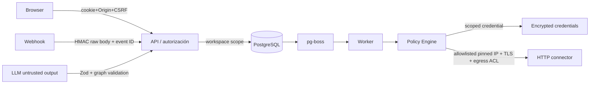

# Automation Control Room — Security Controls v0.1

> **Gate 4E · Estado: propuesta, todavía no aprobada.** Este documento define límites de seguridad y distingue controles implementados como **primitivas aisladas** de medidas pendientes para una API pública.

## Principio de diseño

**Fail closed**: cada capa decide según identidad autenticada, workspace autorizado, policy almacenada en servidor, credencial restringida y ejecución controlada por el worker. El contenido del webhook y las respuestas del LLM nunca conceden privilegios.



Las flechas representan la **arquitectura objetivo**, no una integración ya implementada.

## 1. Webhook firmado (primitiva verificada con tests, API pendiente)

El webhook del operador usa `X-ACR-Timestamp` (Unix segundos), `X-ACR-Event-Id` e `X-ACR-Signature` de formato `sha256=<64 hex>`. Se calcula HMAC-SHA256 con secreto de **al menos 32 bytes** sobre:

```text
UTF8("acr.webhook.v1\n" + timestamp + "\n" + eventId + "\n") || originalRawRequestBody
```

- Tolerancia simétrica: ±300 segundos respecto de un reloj confiable.
- Rechazar firma malformada, cuerpo >64 KiB y event ID fuera del esquema.
- Comparación digest en tiempo constante para digests de longitud válida.
- **No** verificar un cuerpo JSON parseado/re-serializado: usar exactamente los bytes originales y un límite de tamaño antes del parseo.
- **Replay deduplication**: la verificación HMAC **no impide repetir** un evento dentro de la ventana. Solo un `UNIQUE(workspaceId,sourceId,eventId)` guardado atómicamente con la Execution y job evita duplicados. Gate 4D demostró la primitiva de DB; el endpoint no existe todavía.
- Rotación de secreto y validación de reloj/reloj global se especificarán con implementación del operador.

## 2. Autenticación y sesión invitado

Primitivas [sessions.ts](../../packages/security/src/sessions.ts), datos efímeros en [spike PostgreSQL](../../spikes/gate4e/src/guest-store.ts):

- Token de 32 bytes aleatorios (256 bits), transmitido solo por cookie `HttpOnly; Secure; SameSite=Lax` en HTTPS; su hash SHA-256 está en DB.
- Expiración por inactividad: 30 min; plazo absoluto: 24 h. Validar expiración en cada lectura, incluso si falla el cleanup.
- `Origin` exacto, no nulo, debe estar en lista configurada del lado servidor; bloqueo de mutaciones sin origen, más CSRF HMAC ligado a sesión. No se confía en CORS como único control.
- `secure=false` del constructor de cookie solo se admite en desarrollo local. No exponer la cookie por cuerpo de respuesta ni logs.
- Ingreso demo por ruta propia autenticada por cookie; **no** presentar esta acción como webhook HMAC externo.

**Pendiente:** integración Fastify, cookies reales, auth de operador, rotación/revocación persistente, protección de sesión ante múltiples pestañas y pruebas de navegador en dominio real.

## 3. Autorización por workspace e IDOR

- Toda carga consulta `where:{workspaceId:principal.workspaceId,...}` y comprueba propietario del recurso; nunca confiar en `workspaceId` enviado por navegador o IA.
- El principal guest tiene permisos cerrados a demo y **no** tiene `operator.ai.live`, `operator.http.execute` ni acceso a `credential`.
- Un operador debe tener grant explícito en workspace (no basta con estar autenticado).
- Validar el mismo alcance en **SSE, aprobación, borradores, publicación, lista CRM y control de cuota**.
- El spike PostgreSQL comprueba registros aislados por workspace y expiración; no es una prueba de API contra endpoints inexistentes.

## 4. Cuotas y retención en PostgreSQL

- Límite demo candidato: 5 inicios por sesión/24h y **1 ejecución activa**; el spike usa `updateMany WHERE runsStarted < 5 AND activeRuns < 1` con incrementos atómicos.
- Retención absoluta 24h, inactividad 30 min, consultas rechazadas al expirar y purga de workspace y datos sintéticos en cascada; el cleanup real debe ejecutarse como worker periódico.
- **Pendiente:** global 4 ejecuciones concurrentes, límite de creación de sesiones por origen, cupo global diario, scheduler de purga, resistencia a reintentos/abuso distribuido, reserva de cuota en **misma transacción** de creación de Execution+job.

## 5. Secretos y auditoría

- [secrets.ts](../../packages/security/src/secrets.ts): AES-256-GCM, nonce aleatorio de 12 bytes, tag autenticado, AAD con workspace+credential, envelope versionado y rewrap entre claves.
- Las claves de cifrado **no** se almacenan en el repo ni con los secretos; utilizar secreto de entorno/KMS gestionado, con acceso exclusivo al worker.
- La rotación real necesita política de key IDs, key ring controlado, plan de reencrypt, auditoría de acceso y recovery de claves.
- Logs: por defecto **allowlist de campos**, y filtrado estructurado defensivo adicional. Un scrubber no garantiza que todo texto libre sea inocuo; no registrar cuerpos de webhooks, credenciales ni prompts sin minimización.

## 6. SSRF y salida HTTP — defensa parcial, bloqueo público

[ssrf.ts](../../packages/security/src/ssrf.ts) valida:
- `destinationKey` previamente registrado del lado servidor, dominio **exacto**, URL `https:`, puerto 443, sin userinfo/fragment/host IP literal y sin redirects;
- respuestas DNS **todas IPv4 públicas**. Bloquear rangos privados, loopback, link-local y metadatos; **IPv6 no permitido** en MVP.

**Esta validación no hace por sí sola que `fetch(url)` sea seguro.** Para desbloquear un `http.request` real el adaptador debe fijar al socket la IP DNS validada, preservar SNI y comprobar el certificado TLS del hostname original, prohibir proxies y redirects no previstos, controlar redirects/servicios internos y aplicar **firewall/egress ACL a nivel de red**. Si no existe dicho transporte, el conector permanece **deshabilitado** incluso para el operador.

## 7. Prompt injection y separación IA/efectos

- Toda salida del LLM se trata como JSON no confiable; Zod valida estructura y el grafo se valida con política de servidor.
- El LLM no puede publicar, aprobar, ejecutar, leer secretos ni crear rutas HTTP sin policy; `inspectUntrustedAIProposal()` siempre devuelve `approved:false`, `executable:false`.
- Validar prompt injection con tests de output alterado, permisos extras, nombres de conectores y URLs prohibidos. **Esto no demuestra resistencia semántica completa a prompt injection.**

## Matriz de salida

| Control | Evidencia prevista en PR #1 | Sigue pendiente |
|---|---|---|
| HMAC, timestamps, raw bytes | Tests unitarios de firma | Fastify raw-body + UNIQUE receipt en API |
| Cookie, idle/TTL, CSRF, Origin | Primitivas + tests | Sesión web real, middleware, CSRF HTTP |
| Workspace scoping | Policies + tests SQL reales | Repositorios reales y endpoints SSE/approval |
| Cuotas/cleanup demo | Spike PostgreSQL | Global quota, worker cleanup y abuse control |
| Secretos cifrados | AES-GCM tests | Key lifecycle de entorno y auth de vault |
| SSRF | Preflight unit tests | **Transporte pinned IP, TLS y egress firewall: BLOQUEANTE** |
| LLM no autoritativo | Validación Zod/policy tests | AI Planner real y pruebas integradas |

**Criterio de Gate 4E:** pruebas negativas PASS de estas primitivas, revisión de arquitectura y registro explícito de riesgos pendientes. **Esto NO autoriza desplegar una demo pública** hasta implementar/validar las columnas pendientes.
