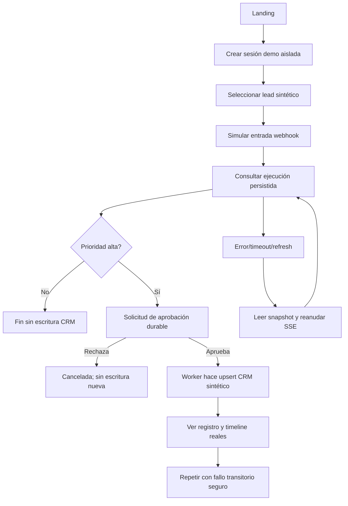

# Automation Control Room — UX Specification v0.3

> **Gate 4F — Propuesta para revisión; NO aprobada ni implementada.**  
> Producto: web app para demo pública anónima y modo operador.  
> Fuente funcional: [PRD](../product/PRD.md), [workflows v1](../contracts/WORKFLOW_SCHEMA.md), [OpenAPI](../contracts/openapi.yaml).  
> Escenarios: [DEMO_SCENARIOS](../product/DEMO_SCENARIOS.md), [guion verificable](DEMO_ACCEPTANCE_SCRIPT.md).

## Principio de UX: mostrar evidencia, no teatro

Automation Control Room debe demostrar el ciclo **entrada → ejecución → aprobación → escritura → auditoría**, donde cada estado visible procede de una respuesta de API o evento persistido. Una animación de nodo, por sí sola, jamás puede significar una escritura confirmada.

La demo es gratuita y segura: no requiere usuario, API key ni llamadas pagas. La clasificación será una **fixture determinista claramente señalizada**. IA real y planificador de lenguaje natural: **solo operador** con proveedor configurado, separados de la demo.

## Navegación y rutas candidatas

| Ruta conceptual | Público | Objetivo | Operaciones backend esperadas |
|---|---|---|---|
| / | Todos | Visión del producto, código, CTA probar | Ninguna obligatoria |
| /demo | Invitado | Recorrido guiado de 90 s | POST demo/sessions, POST demo/events |
| /workflows/:id | Dueño de sesión u operador | Canvas, inspector de nodo, validation/publish | POST/PUT/GET workflow, publish |
| /runs/:id | Dueño de sesión u operador | Estado, eventos, intentos, auditoría | GET execution y SSE |
| /approvals | Dueño de sesión u operador | Aprobar/rechazar acciones | GET approvals **por diseñar en API**, POST decision |
| /demo/crm | Invitado de la sesión | Ver registro ficticio real | GET demo/crm |
| /settings | Operador | Proveedor IA, webhook, secretos y destinos | Contratos adicionales **por diseñar** |

**Brecha conocida:** OpenAPI actual no define un listado GET de approvals ni endpoints completos de settings. No construir UX asumida sobre rutas inexistentes: añadir contratos en implementación de API/4C revision.

## Flujo 1 — Visita guiada anónima

**Datos consistentes:** `lead_demo_001` (alta) se utiliza para feliz/reintento/rechazo con **event IDs diferentes** en cada recorrido. `lead_demo_002` (media) y `lead_demo_003` (baja) siguen la rama sin approval ni escritura en la versión canónica; se usan para enseñar la rama condicional, **no** como pruebas de rechazo/retry.

### Estados visibles obligatorios

| UI | Condición real | Feedback | CTA permitido |
|---|---|---|---|
| Cargando sesión | aún no se recibió sesión | placeholder + texto, sin éxito | Reintentar carga |
| Preparado | sesión válida, fixture cargada | «Fixture de demostración; sin llamada a IA» | «Simular entrada» |
| Enviando entrada | POST pendiente | disabled + loader | Ninguno (sin doble submit) |
| En cola / ejecutando | snapshot queued/running | nodo activo + timeline | Abrir inspector |
| Esperando aprobación | snapshot waiting_approval + approval válida | acción, destino, digest, expiración | Aprobar / Rechazar |
| Reintentando | snapshot retrying + evento persistido | intentos y motivo sin datos sensibles | Ver detalles |
| Completado | snapshot completed + CRM recuperado de API | vínculo a registro real | Ver auditoría / reiniciar recorrido |
| Needs review | snapshot needs_review | explicar incertidumbre y detener ejecución | Operador: revisión; invitado: detalle, nunca retry ciego |
| Falló / cancelado | snapshot failed/cancelled | razón tipada, sin triunfalismo | Nuevo run si hay cuota |
| Sin conexión/SSE caído | stream desconectado | «Reconectando; estado por confirmar» | Reintentar GET snapshot |
| Sesión vencida / cuota | 401/403/409/429 | motivo claro, Retry-After donde exista | Reiniciar sesión o volver luego |

## Flujo 2 — Editor de workflows

El canvas React Flow permite zoom, pan, mover y enlazar nodos, editar la configuración tipada y publicar **nueva versión inmutable**. La validación local adelanta errores; la validación de publicación **siempre** corre en servidor contra una policy del workspace.

- Panel lateral izquierdo: paleta de 8 nodos. Modo invitado: `http.request` deshabilitado y señalizado. Modo operador: puede mostrarse solo si existe destino allowlisted y runtime seguro **comprobado**.
- Centro: canvas y aristas; condición con puertos etiquetados true/false. **Sin fanout paralelo, joins, loops ni scripts arbitrarios** en v1.
- Panel lateral derecho: propiedades del nodo seleccionado y errores por campo; no permitir guardar secretos en JSON del graph.
- Barra superior: nombre, versión publicada activa, «Cambios sin publicar», estado de guardado y botón «Validar / Publicar».
- Estado de publicación: devuelve workflowVersionId+graphDigest desde API; no reemplazar versión activa de una Execution ya comenzada.
- En errores 409 de CAS: diálogo que ofrece «Recargar última revisión»; nunca sobrescribir trabajo silenciosamente.
- En errores 422: lista con ID de nodo/campo y navegación enfocada al error; para exceso de presupuesto indicar límites restantes.
- Para operador: entrada de lenguaje natural genera **borrador propuesto**, etiqueta de proveedor real y botón de revisar. **No** publica ni ejecuta automáticamente.

## Flujo 3 — Inspector de ejecución

- Encabezado: ID abreviado, versión de workflow, estado textual, startedAt/duración, modo IA, enlaces a CRM/Approval.
- Canvas en modo **solo lectura** con estados por nodo basados en DB (`pending/ready/running/succeeded/skipped/retrying/failed/needs_review`), sin confundir skip con error.
- Timeline lateral: eventos `(executionId, sequence)` persistidos, orden estricto, hora, nodeId, intento, mensaje sanitizado.
- Detalle de paso: inputs/outputs **redactados**, code de error, intentos y política de retry; sin secretos, firmas ni tokens.
- SSE: `Last-Event-ID` cursor, deduplicación y detección de gaps; ante hueco, **no inventar eventos**, detener proyección y recargar snapshot/eventos desde API.
- Acción de cancelación: aviso «detiene próximos pasos, no deshace efectos en curso»; respetar CAS y estado de backend.
- Ante incertidumbre externa: detener, mostrar `needs_review`; jamás ofrecer «Reintentar todo» sin reconciliación.

## Flujo 4 — Aprobaciones

- La tarjeta muestra **qué se va a escribir**, en qué destino (demo CRM o servicio operador permitido), versión, solicitante/run, razón, digest de payload y vencimiento.
- Dos botones distinguibles por texto: Aprobar y Rechazar. Al pulsarlos, bloquear doble click, pero permitir reconsulta del resultado.
- En caso de decisión competidora/expirada, backend responde 409 y UI carga estado definitivo. No declarar éxito antes del 200.
- Approval rechazada produce `cancelled` sin nuevo efecto. **No** se aprueba automáticamente al vencer.

## Flujo 5 — CRM ficticio

Tabla con externalKey, prioridad, categoría, updatedAt, ejecución origen y estado de upsert. Solo registros de la sesión y con valores sintéticos. Después de retry seguro, se ve **una fila** por externalKey. Vacío es un estado explícito: «No hay registros confirmados».

## Responsive y accesibilidad

- Desktop >=1024 px: barra lateral de navegación, canvas central, panel de propiedades o timeline a la derecha.
- Tablet 768–1023 px: canvas completo; panel derecho en drawer sin tapar botones críticos.
- Mobile <768 px: la demo y el inspector son **prioridad**; timeline como lista, canvas opcional colapsado, acciones y approval en panel vertical. El editor puede ofrecer modo inspección con aviso de edición limitada, no una experiencia falsa.
- Criterios WCAG 2.2 AA como **objetivo**, no como certificación: teclado y foco visible, Escape cierra modales, Enter/Espacio activan botones, labels accesibles, estados indicados por texto además de color, live regions con anuncios no repetitivos, contrastes comprobables, reduced motion.
- Mensajes en español como idioma de demo inicial. Internacionalización de cadenas vía keys y EN/FR podrá añadirse en Fase 5; no prometer traducciones completas inexistentes.

## Design tokens candidatos (no una identidad visual aprobada)

Espaciado base 4px, escala 8/12/16/24/32; tipografía sistema; densidad de dashboard media; radios 8–12px; canvas con grid sobria; colores de estado definidos como **tokens semánticos** (success, warning, danger, pending, neutral), no como hex obligatorios. Debe funcionar sin depender del color para comunicar estado.

## Entregables de revisión Gate 4F

1. [Wireframes textuales desktop/mobile](WIREFRAMES.md) y estados de carga/errores.
2. [Guion de aceptación](DEMO_ACCEPTANCE_SCRIPT.md) con evidencia API/DB requerida.
3. [Contrato de proyección de eventos](../../packages/ux-contracts/README.md) probado.
4. [Runbook de operación](../operations/DEPLOYMENT_RUNBOOK.md), [observabilidad](../operations/OBSERVABILITY.md) y [Compose de validación](../../ops/compose/validation.yml).
5. [Release gate](../quality/RELEASE_GATES.md) documentado; pruebas Playwright reales y auditoría WCAG **pendientes hasta existir frontend**.

**Estado:** UX documentada y preparada para implementar, pero no probada con usuarios ni con pantallas reales.
